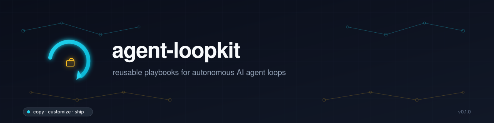

# agent-loopkit

> **Reusable playbooks for autonomous AI agent loops — copy, customize, ship.**



A growing catalog of battle-tested **recipes** for autonomous AI agent workflows: each one is a self-contained, opinionated package that captures a cron-driven loop (the agent, the prompt, the schedule, the scripts, the secrets layout, the failure modes) so you can drop it into any Hermes-style agent runtime and have it working the same day — not the same quarter.

Think of it as a *cookbook* for agent loops: pick a recipe, change the variables, ship.

---

## Why this exists

Autonomous agents are powerful but **brittle at the seams**. The hard part isn't the model call — it's:

- the prompt that frames the loop correctly so the agent doesn't drift or hallucinate
- the schedule cadence that survives weekends and rate limits
- the scripts that handle "I can't reach the API" / "the page id rotated" / "the brand asset is missing"
- the reviewer gate that catches a bad post before it goes live
- the history file that prevents the same niche from being picked twice

This repo packages all of those decisions into one file per recipe, so you don't have to rediscover them.

## When to use

- You want to **clone an existing autonomous loop** that already runs in production somewhere and adapt it to your own business.
- You're building a **new cron-driven agent loop** and want a vetted template instead of starting from a blank prompt.
- You want to **standardize** how your team ships agent automations so they're auditable, restartable, and replaceable.

**Don't use for:** one-shot scripts, interactive chat agents, or non-recurring tasks. If you only need to run something once, use a plain script.

---

## How a recipe is shaped

Every recipe in `recipes/` follows the same shape so you can read them in any order:

```
recipes/<recipe-slug>/
├── RECIPE.md             # the canonical playbook (the recipe)
├── cron.config.yaml      # the schedule + toolsets + delivery settings
├── prompts/
│   └── system.txt        # the agent's system prompt
├── scripts/              # any helpers the loop depends on
├── assets/               # logos, references, sample posts
├── references/           # longer docs the agent reads mid-run
├── tests/                # structural tests + a tiny smoke test
└── examples/
    └── env.template      # required env vars (no real values)
```

`RECIPE.md` is the heart: it's the human-readable playbook with the goal, the prompt, the schedule, the failure modes, and the verification checklist. If you only read one file per recipe, read that one.

`cron.config.yaml` is the machine-readable counterpart: drop it into any Hermes-style scheduler (cron, GitHub Actions, K8s CronJob) and the loop comes alive.

See `RECIPE_TEMPLATE.md` for the exact template, and `docs/authoring-a-recipe.md` for the workflow to add your own.

---

## Recipes

| Recipe | Domain | Cadence | Status |
|---|---|---|---|
| [`tgo-full-funnel-autopilot`](recipes/tgo-full-funnel-autopilot/) | Local-business Facebook lead funnel (niche → landing → post → comment guard) | 3×/day | **Production** (paused for review) |

More recipes coming. Each one follows the same template so you can fork, rename, and ship.

---

## Quickstart

### 1. Pick a recipe

```bash
git clone https://github.com/ooovenenoso/agent-loopkit.git
cd agent-loopkit
ls recipes/
```

### 2. Copy it to your own project

```bash
cp -r recipes/tgo-full-funnel-autopilot ~/my-agent-loop
cd ~/my-agent-loop
```

### 3. Edit the variables

Every recipe has a **"Variables you must change"** section at the top of `RECIPE.md`. Rename, swap the brand asset, point secrets at your accounts, adjust the cadence.

### 4. Drop the cron

```bash
# Example for a Hermes cronjob — see cron.config.yaml for the exact shape
hermes cron create \
  --from ./cron.config.yaml \
  --prompt "$(cat prompts/system.txt)" \
  --skills facebook-platform-automation,local-business-funnel-autopilot
```

Or wire it into GitHub Actions, a K8s CronJob, or a plain `cron` entry — see `docs/deployment-targets.md`.

### 5. Verify

Each recipe ships with a `tests/` directory that runs the structural validators and a smoke test. The recipe's `RECIPE.md` ends with a verification checklist you can copy-paste.

---

## Repository structure

```
agent-loopkit/
├── README.md                       # you are here
├── RECIPE_TEMPLATE.md              # the canonical recipe shape
├── CONTRIBUTING.md                 # how to add a recipe
├── CHANGELOG.md                    # release notes
├── LICENSE                         # MIT
├── SECURITY.md                     # how secrets are handled
├── assets/
│   ├── banner.svg / banner.png     # README header
│   ├── logo.svg / logo.png         # project mark
│   └── icon.svg                    # small icon
├── recipes/                        # the actual playbooks
│   └── tgo-full-funnel-autopilot/
├── templates/                      # blank scaffolds for new recipes
├── scripts/                        # repo-level tools (validate, lint)
├── references/                     # shared reference docs
├── docs/                           # longer guides
│   ├── authoring-a-recipe.md
│   ├── deployment-targets.md
│   └── adapting-an-existing-loop.md
└── .github/
    ├── ISSUE_TEMPLATE/
    └── workflows/
```

## Contributing a recipe

See [`CONTRIBUTING.md`](CONTRIBUTING.md). Short version:

1. Copy `RECIPE_TEMPLATE.md` into `recipes/<your-slug>/RECIPE.md`.
2. Fill in every section. The validator will reject recipes with empty "Failure modes" or "Verification" sections.
3. Add a `cron.config.yaml` and a `prompts/system.txt`.
4. Run `python3 scripts/validate_recipe.py recipes/<your-slug>/` — must exit 0.
5. Open a PR. The recipe CI will lint frontmatter, check cross-links, and run the smoke test.

## License

MIT — see [`LICENSE`](LICENSE). Recipes are templates; the **brand assets, page tokens, and customer data referenced in any recipe must not be reused as-is** for a different business. See [`SECURITY.md`](SECURITY.md).

## Provenance

Started as a private extraction of production cron flows originally running inside [Hermes Agent](https://github.com/ooovenenoso/hermes-agent) (TGO Full Funnel Autopilot, et al.). The structure here is generic — drop the recipes into any agent runtime that supports scheduled prompts, secrets, and skill loading.

---

*Maintained by [@ooovenenoso](https://github.com/ooovenenoso). If a recipe saved you weeks, a star helps others find it.*